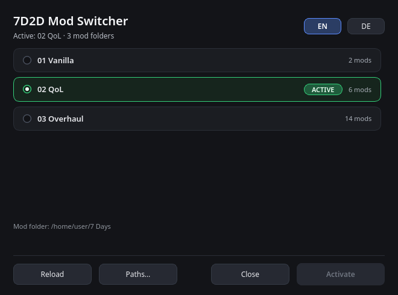
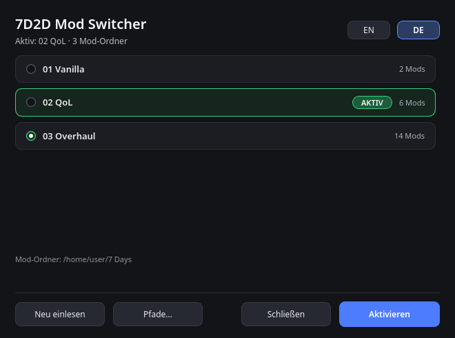
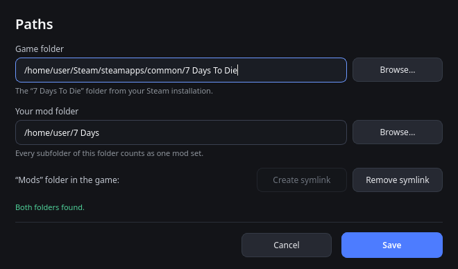

# 7D2D Mod Switcher

**English** · [Deutsch](#deutsch)

A small desktop app that switches the mod folder of **7 Days to Die** — one click, no copying
files around. It ships as a self-contained AppImage, keeps a dark UI, and speaks English and
German (switchable inside the app, remembered).



## What it does

The game loads its mods from `<game folder>/7 Days To Die/Mods`. The app puts a symlink there
that points at one of your prepared mod sets, so you can jump between mod packs without moving
a single file:

- lists every mod set in your own mod folder, with the number of mods inside
- marks the active set in green and shows an **ACTIVE** badge
- click anywhere on a row to select it, then **Activate**
- never deletes anything: a real `Mods` folder is renamed to `Mods-Original-<date>` first
- the symlink can be created and removed again from inside the app at any time

## Download

Ready-to-run **AppImage** for x86_64: see [Releases](../../releases/latest). Download it, set
`chmod +x`, double-click. Python and PySide6 are bundled — nothing to install. On systems
without FUSE2 use `./7D2D-Mod-Switcher-x86_64.AppImage --appimage-extract-and-run`.

## Run from source

Requirements: Linux, Python 3.10+ and **PySide6**

```bash
sudo pacman -S pyside6                    # Arch/CachyOS
python3 -m pip install --user PySide6     # other distributions

python3 mod_switcher.py
```

Optional desktop starter: copy `packaging/7d2d-mod-switcher.desktop` to
`~/.local/share/applications/` and adjust the path in `Exec=`.

## Language

`EN` / `DE` in the top right of the main window. The choice is written to the config file and
restored on the next start. Without a saved choice the app follows the system locale and falls
back to English.



## Paths

On first start the game folder is detected automatically: every Steam library listed in
`~/.local/share/Steam/steamapps/libraryfolders.vdf` (Flatpak Steam included). If nothing is
found, pick it via **Paths…**. Your own mod folder defaults to `~/7 Days`.

Both paths and the language are remembered in `~/.config/7d2d-mod-switcher/config.json`:

```json
{
  "game_dir": "/path/to/7 Days To Die",
  "mod_base": "/path/to/your/mods",
  "language": "en"
}
```

Inside the mod folder **every subfolder is one mod set** (e.g. `Vanilla`, `Overhaul`). The app
lists all of them with their mod count; the active one is highlighted in green.



## Safety

The app never deletes files. It only replaces the `Mods` symlink inside the game folder.

If `Mods` is still a **real directory**, the app asks on startup:

> **Create a symlink for Mods?** You can undo this in the app at any time.

Answering *Yes* renames the existing folder to `Mods-Original-<date>` (nothing inside is lost)
and then links the first mod set. *No* leaves everything as it is; you can do it later via
**Paths… → Create symlink**.

The **Paths…** dialog offers two buttons for this:

- **Create symlink** — backs up a real folder and creates the symlink.
- **Remove symlink** — removes only the symlink; the game then starts without mods. An existing
  `Mods-Original-<date>` backup stays where it is.

> **Windows:** not supported yet. The app already falls back to Windows Steam folders and
> `%APPDATA%` for its config, but directory links and packaging still need work.

## Usage

- Click anywhere on a row to select that mod set.
- **Activate** switches over; if the set is already active the button reads *Already active*.
- **Reload** re-reads the mod folder (after adding a set).
- **Paths…** changes game folder, mod folder and the symlink.

## Environment variables (tests, special cases)

`MODSWITCH_GAME_DIR`, `MODSWITCH_MOD_BASE`, `MODSWITCH_CONFIG`, `MODSWITCH_UI_KIT` and
`MODSWITCH_LANG` override the settings. `MODSWITCH_AUTO=<name>` activates a set and quits
immediately, `MODSWITCH_AUTO=__close__` only opens and closes the window, `MODSWITCH_NO_ASK=1`
suppresses the startup question.

## Layout

| Path | Purpose |
|---|---|
| `mod_switcher.py` | the application |
| `i18n.py` | all English and German texts |
| `assets/` | logo (window/starter) |
| `ui_kit/` | shared look (colors, radio buttons, check marks) |
| `tests/` | checks against a throwaway folder, README screenshots |
| `packaging/appimage/` | recipe and build for the AppImage |
| `packaging/7d2d-mod-switcher.desktop` | starter file for a local install |

## Tests

```bash
QT_QPA_PLATFORM=offscreen python3 tests/test_mod_switcher.py
```

The checks run in a temporary directory and never touch the real game folder.

## Build the AppImage

```bash
cd packaging/appimage
./build.sh
```

It needs `python-appimage` and `appimagetool` (the script creates its own venv in the build
folder and downloads both).

## License

MIT — see [LICENSE](LICENSE).

---

## Deutsch

Kleine Desktop-Anwendung, die den Mod-Ordner von **7 Days to Die** umschaltet — ein Klick,
kein Kopieren von Dateien. Sie kommt als eigenständiges AppImage, hat eine dunkle Oberfläche
und spricht Deutsch und Englisch (in der App umschaltbar und gemerkt).

Das Spiel lädt seine Mods aus `<Spielordner>/7 Days To Die/Mods`. Die Anwendung legt dort
einen Symlink an, der auf einen von mehreren vorbereiteten Mod-Sätzen zeigt:

- listet alle Mod-Sätze im eigenen Mod-Ordner, jeweils mit Anzahl der enthaltenen Mods
- markiert den aktiven Satz grün und mit **AKTIV**
- Klick irgendwo auf einen Balken wählt aus, **Aktivieren** schaltet um
- löscht nie etwas: ein echter Ordner `Mods` wird vorher zu `Mods-Original-<Datum>` umbenannt
- Symlink lässt sich jederzeit in der App wieder anlegen und entfernen

### Download

Fertige **AppImage** für x86_64 unter [Releases](../../releases/latest): herunterladen,
`chmod +x` setzen, doppelklicken. Python und PySide6 sind enthalten. Ohne FUSE2:
`./7D2D-Mod-Switcher-x86_64.AppImage --appimage-extract-and-run`.

### Aus dem Quellcode starten

```bash
sudo pacman -S pyside6                    # Arch/CachyOS
python3 -m pip install --user PySide6     # andere Distributionen

python3 mod_switcher.py
```

Wahlweise als Starter: `packaging/7d2d-mod-switcher.desktop` nach
`~/.local/share/applications/` kopieren und den Pfad in `Exec=` anpassen.

### Sprache

`DE` / `EN` oben rechts im Hauptfenster. Die Wahl landet in der Konfigurationsdatei und gilt
beim nächsten Start wieder. Ohne gespeicherte Wahl folgt die App der Systemsprache und fällt
sonst auf Englisch zurück.

### Pfade

Beim ersten Start wird der Spielordner automatisch gesucht: alle Steam-Bibliotheken aus
`~/.local/share/Steam/steamapps/libraryfolders.vdf` (auch Flatpak-Steam). Wird nichts
gefunden, lässt er sich über **Pfade…** auswählen. Der eigene Mod-Ordner ist voreingestellt
auf `~/7 Days`.

Beide Pfade und die Sprache werden in `~/.config/7d2d-mod-switcher/config.json` gemerkt:

```json
{
  "game_dir": "/pfad/zu/7 Days To Die",
  "mod_base": "/pfad/zu/eigenen/mods",
  "language": "de"
}
```

Im Mod-Ordner ist **jeder Unterordner ein Mod-Satz** (z. B. `Vanilla`, `Overhaul`). Die
Anwendung zeigt alle Sätze mit der Anzahl enthaltener Mods; der aktive ist grün markiert.

### Sicherheit

Die Anwendung löscht keine Dateien. Sie ersetzt ausschließlich den Symlink `Mods` im
Spielordner.

Ist `Mods` noch ein **echter Ordner**, fragt die Anwendung beim Start:

> **Symlink für Mods anlegen?** Kann jederzeit in der App rückgängig gemacht werden.

Mit „Ja“ wird der vorhandene Ordner zuerst nach `Mods-Original-<Datum>` umbenannt (nichts
darin geht verloren) und dann der Symlink auf den ersten Mod-Satz angelegt. Mit „Nein“ bleibt
alles, wie es ist; die Frage lässt sich über **Pfade… → Symlink anlegen** jederzeit nachholen.

Im Dialog **Pfade…** stehen dafür zwei Knöpfe:

- **Symlink anlegen** — sichert einen echten Ordner und legt den Symlink an.
- **Symlink entfernen** — entfernt nur den Symlink; das Spiel startet danach ohne Mods. Eine
  vorhandene Sicherung `Mods-Original-<Datum>` bleibt liegen.

> **Windows:** noch nicht unterstützt. Die App kennt bereits die Windows-Steam-Ordner und
> `%APPDATA%` für ihre Konfiguration, aber Verzeichnis-Links und die Paketierung fehlen noch.

### Bedienung

- Klick irgendwo auf einen Balken wählt den Mod-Satz aus.
- **Aktivieren** schaltet um; ist der Satz schon aktiv, heißt der Knopf „Bereits aktiv“.
- **Neu einlesen** liest den Mod-Ordner neu (nach dem Anlegen eines Satzes).
- **Pfade…** ändert Spielordner, Mod-Ordner und den Symlink.

### Umgebungsvariablen (Tests, Sonderfälle)

`MODSWITCH_GAME_DIR`, `MODSWITCH_MOD_BASE`, `MODSWITCH_CONFIG`, `MODSWITCH_UI_KIT` und
`MODSWITCH_LANG` überschreiben die Einstellungen. `MODSWITCH_AUTO=<name>` aktiviert einen Satz
und beendet die Anwendung sofort, `MODSWITCH_AUTO=__close__` öffnet und schließt sie nur,
`MODSWITCH_NO_ASK=1` unterdrückt die Start-Rückfrage.

### Aufbau

| Pfad | Zweck |
|---|---|
| `mod_switcher.py` | die Anwendung |
| `i18n.py` | alle deutschen und englischen Texte |
| `assets/` | Logo (Fenster/Starter) |
| `ui_kit/` | gemeinsames Aussehen (Farben, Radiobuttons, Häkchen) |
| `tests/` | Prüfläufe gegen einen Wegwerf-Ordner, README-Bilder |
| `packaging/appimage/` | Rezept und Baulauf für das AppImage |
| `packaging/7d2d-mod-switcher.desktop` | Starterdatei für lokale Installation |

### Prüfen

```bash
QT_QPA_PLATFORM=offscreen python3 tests/test_mod_switcher.py
```

Die Prüfungen laufen in einem temporären Verzeichnis und fassen den echten Spielordner nicht an.

### AppImage bauen

```bash
cd packaging/appimage
./build.sh
```

Nötig sind `python-appimage` und `appimagetool` (das Skript legt beides in einer eigenen venv
im Build-Ordner ab und lädt sie herunter).

### Lizenz

MIT — siehe [LICENSE](LICENSE).
